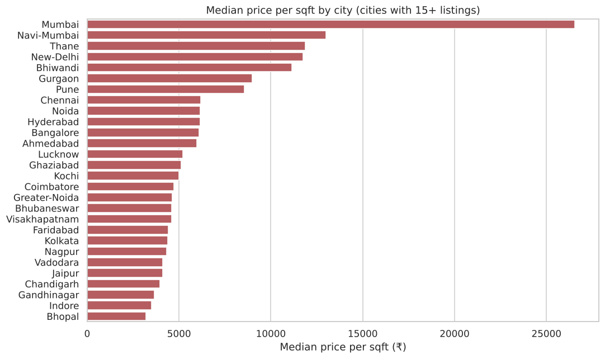
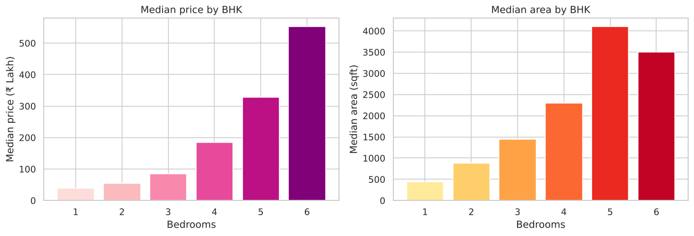
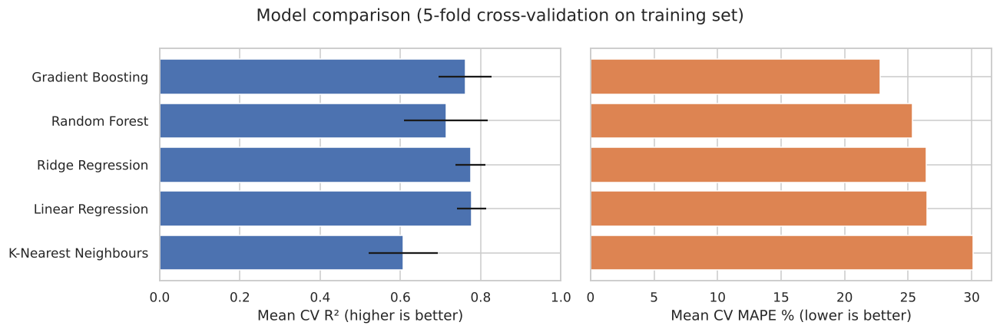
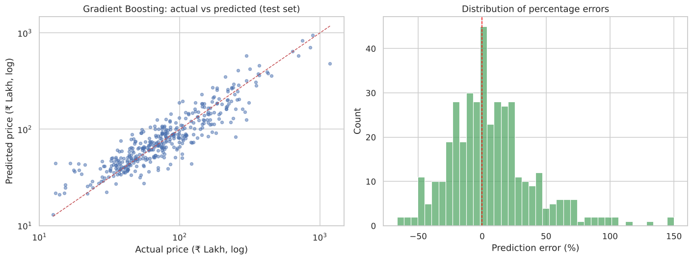

# Real Estate Price Analysis & Prediction — India (MagicBricks)

An end-to-end data science project on Indian residential property listings scraped from [MagicBricks](https://www.magicbricks.com). It covers web scraping, data cleaning, exploratory analysis and a machine-learning model that estimates a property's price from its size, location and features.

📄 **[Full report (PDF)](reports/Real_Estate_Price_Prediction_Report.pdf)**

---

## Highlights

- **Scraped 2,989 listings across 59 Indian cities** with Selenium and BeautifulSoup.
- **Cleaned the data down to 2,004 reliable listings.**
  - Parsed prices (`₹1.18 Cr` → 11,800,000) and converted areas from sqft, sq yard and sq metre.
  - Removed 932 duplicate listings.
  - Fixed latitude and longitude, which the scraper had swapped.
- **Mumbai is the clear price leader** at about ₹26,500 per sqft, roughly double any other city.
- **Gradient Boosting model:** test R² of **0.81** with a typical error of about **25%**.
- **Found and fixed target leakage.** The original model used *price per sqft* as an input, which is calculated from the price itself. That inflated accuracy to a misleading R² of 0.99.

## Project Pipeline

| Step | Notebook | What it does |
|---|---|---|
| 1. Data collection | [`01_data_collection.ipynb`](notebooks/01_data_collection.ipynb) · [`src/scraper.py`](src/scraper.py) | Scrapes listing cards (title, price, area, locality, coordinates, amenities) and tests the parser offline |
| 2. Data cleaning | [`02_data_cleaning.ipynb`](notebooks/02_data_cleaning.ipynb) | Parses text to numbers, fixes data errors, adds state and city tier, removes duplicates and outliers |
| 3. EDA | [`03_eda.ipynb`](notebooks/03_eda.ipynb) | Price distributions, city, state and tier comparisons, BHK, furnishing and property-type effects, correlations |
| 4. Modelling | [`04_price_prediction_model.ipynb`](notebooks/04_price_prediction_model.ipynb) | Compares 5 models with cross-validation, evaluates on a held-out test set, explains feature importance and saves the model |

## Key Insights

1. **Location drives price per sqft.** Mumbai (~₹26,500/sqft) is followed by Navi Mumbai, Thane and New Delhi (~₹11,800–13,000). Tier-1 cities have a median of ~₹7,900/sqft, compared with ~₹6,000 for Tier-2.
2. **Size drives total price.** The median price rises from ₹55 Lakh for a 2 BHK to ₹85 Lakh for a 3 BHK and ₹184 Lakh for a 4 BHK.
3. **New properties list higher than resale**, and semi-furnished homes have the highest median price in both groups.
4. **The best predictors are log(area) and city**, followed by exact location (latitude and longitude) and the number of bathrooms.

| | |
|---|---|
|  |  |
|  |  |

## Model Results

| Model | CV R² | CV MAPE |
|---|---|---|
| **Gradient Boosting** (selected) | 0.76 | **22.8%** |
| Random Forest | 0.71 | 25.4% |
| Ridge Regression | 0.78 | 26.5% |
| Linear Regression | 0.78 | 26.5% |
| K-Nearest Neighbours | 0.61 | 30.1% |

**Held-out test set (Gradient Boosting):** R² 0.81 · log-scale R² 0.83 · MAPE 25% · median absolute error ₹13.8 Lakh.

The target is `log(price)`, because prices range from ₹9 Lakh to ₹24 Cr. Models are ranked by percentage error, so cheap and expensive homes count equally.

## Data Cleaning Decisions

| Problem found | Fix |
|---|---|
| Prices stored as text (`₹92.8 Lac`, `₹1.18 Cr`, "Call for Price") | Regex parsing into rupees; listings without a price are dropped |
| Areas in mixed units | Converted to sqft (1 sq yd = 9 sqft, 1 m² = 10.764 sqft) |
| Latitude and longitude swapped by the scraper | Swapped back and checked against India's coordinate range |
| 932 duplicate listings | Deduplicated on `Property Id` |
| Society-wide parking counts (e.g. "835 Covered") | Treated as not specified |
| Typo prices (e.g. a 2 BHK at ₹60,000/sqft in Trivandrum) | Removed listings more than 3× above or below their city's median price per sqft (1.4% of rows) |

## Project Structure

```
real-estate-price-prediction/
├── data/
│   ├── raw/MagicBricks_Raw.xlsx               # scraped listings (2,989 × 27)
│   └── processed/magicbricks_cleaned.csv      # cleaned dataset (2,004 × 20)
├── notebooks/                                 # 01 → 04, run in order
├── src/scraper.py                             # MagicBricks scraper (Selenium 4 + BeautifulSoup)
├── models/price_model.joblib                  # trained Gradient Boosting pipeline
├── images/                                    # charts exported by the notebooks
├── reports/Real_Estate_Price_Prediction_Report.pdf
├── requirements.txt
└── README.md
```

## Tools

Python · Pandas · NumPy · Matplotlib · Seaborn · Scikit-learn · Selenium · BeautifulSoup · Jupyter

## How to Run

```bash
git clone https://github.com/<your-username>/real-estate-price-prediction.git
cd real-estate-price-prediction
pip install -r requirements.txt
jupyter notebook
```

Open the notebooks in `notebooks/` and run them in order (01 → 04).

**Use the trained model:**

```python
import joblib, numpy as np, pandas as pd
model = joblib.load('models/price_model.joblib')
home = pd.DataFrame([{'Log Area': np.log(1100), 'Bedrooms': 2, 'Bathroom': 2, 'Parking': 1,
                      'Latitude': 23.03, 'Longitude': 72.58, 'City': 'Ahmedabad', 'Tier': 'Tier2',
                      'State/Territory': 'Gujarat', 'Property Type': 'Flat', 'Transaction': 'New Property',
                      'Furnishing': 'Semi-Furnished', 'Status': 'Ready to Move'}])
print(f"Estimated price: ₹{model.predict(home)[0] / 1e5:.1f} Lakh")
```

**Collect fresh data** (needs Chrome and an internet connection):

```bash
python src/scraper.py --cities Pune Ahmedabad --pages 2
```

## Limitations and Next Steps

- About 2,000 listings across 59 cities, so smaller cities have few examples.
- These are **asking** prices from listings, not final sale prices.
- Next steps: add floor level, amenities and age of the property; collect more data per city; and serve the model through a simple web app.
